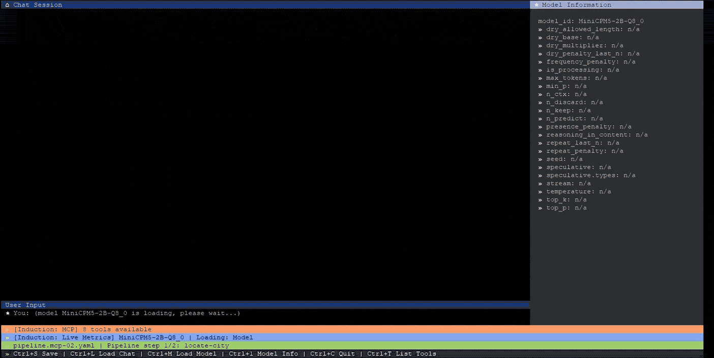
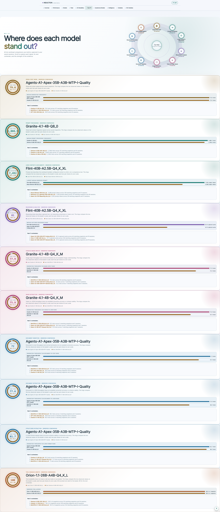

# Induction

The Linux image metadata appliance is a beta, work-in-progress feature. See
[docs/INDUCTION-IMAGE-META.md](docs/INDUCTION-IMAGE-META.md) for its current
status, limitations, and usage.

Induction is a Go client for llama.cpp-compatible servers. It provides
config-driven chat inference, multimodal requests, structured output,
pipelines, telemetry, model inspection, health checks, and MCP tool support.

Induction expects a reachable llama.cpp-compatible server with an OpenAI-style
`/v1` API. Configure the server and runtime settings in `induction.yaml`;
[`induction.example.yaml`](induction.example.yaml) is a starting point.



## Features

1. **Config-driven multi-step pipelines** — Declarative YAML workflows for chaining inference, branching decisions, reusable prompts, tool calls, file inputs, artifacts, and final outputs.

   A document workflow might extract text from a PDF, summarize each section, classify risks, and produce a final JSON report. Each stage remains configurable, inspectable, and reusable. [Pipeline authoring documentation](docs/PIPELINES.md#authoring) · [Run the examples with your own models](docs/PIPELINES.md#running-the-repository-pipelines-with-your-own-models)

2. **Batch pipeline execution** — Run the same pipeline across many documents or images with isolated items, persisted state, retryable failures, and regenerated artifacts.

   A batch image workflow can analyze hundreds of product photos independently. Each image receives its own result, while failed items can be rerun without repeating successful work. [Batch pipeline documentation](docs/PIPELINES.md#batch-pipelines)

3. **MCP and application-tool orchestration** — Native MCP integration with tool availability, tool-use outcomes, structured telemetry, and pipeline-level tool workflows.

   During a travel-planning workflow, a model can use an MCP weather service to check conditions at a destination. The pipeline can also record whether the tool was available, requested, and used successfully. [MCP documentation](docs/MCP.md) · [Application Tools documentation](docs/APPLICATION-TOOLS.md)

4. **Telemetry-driven model comparison** — A generated dashboard (Overview, Performance, Models, Fleet, I/O Modalities, Best Fit, Systemone Models, Intelligence, Variables, and SIA Variables) comparing real model behavior across throughput, startup cost, reasoning density, output yield, workload mix, and model fingerprints. The optional SIA-based Intelligence view is experimental.

   After running several models against real workloads, the dashboard can show which one is best for interactive prompts, deep reasoning, or high-volume processing. These comparisons use observed behavior rather than isolated benchmark results. [Dashboard documentation](docs/DASHBOARD.md)

5. **Decision routing inside pipelines** — Bounded classification steps that conditionally route later stages without requiring custom application code.

   Incoming support requests can be classified as billing, technical, or urgent. Each category can then follow a different analysis, tool-use, and response-generation path. [Decision routing examples](docs/EXAMPLES-DECISION-ROUTING.md)

6. **Unified multimodal document workflows** — Images, PDFs, OCR-style processing, remote URLs, local files, and batch inputs all use the same pipeline abstraction.

   A document workflow can accept invoice PDFs and product images from local paths or HTTPS URLs. It can extract their contents, compare the results, and produce a consolidated structured response. [Document pipeline examples](docs/EXAMPLES-DOCUMENT.md) · [Vision and image pipeline examples](docs/EXAMPLES-VISION-IMAGE.md)

7. **Artifact-oriented execution** — Intermediate and final results are persisted as named artifacts, making pipeline runs inspectable, reusable, and suitable for downstream automation.

   A research workflow can save extracted facts, evidence tables, summaries, and the final report as separate artifacts. Each stage can be reviewed independently or reused by a later workflow. [Generated pipeline example](docs/EXAMPLES-GENERATED-TASK-MANAGEMENT.md)

8. **Automatic persistence and performance history** — Sessions, inferences, and workflows are saved locally with per-inference metrics, creating a durable performance history for model analysis and best-fit recommendations.

   Once several models have been tested across real workloads, their historical latency, throughput, output characteristics, and workload mix can be reviewed together. This history helps identify the best model for a particular task. [Inference and session documentation](docs/INFERENCE.md) · [Dashboard documentation](docs/DASHBOARD.md)

## Dependencies

- A running llama.cpp-compatible inference server started with the `--metrics`
  flag and using the expected OpenAI-style `/v1` API.
- Go 1.26.4 or newer to build or run Induction from source.
- GoReleaser to produce release artifacts.
- A Linux AMD64 host for the current release configuration.
- `ripgrep` (`rg`) on `PATH` for the `search_workspace` application tool.
- Access to the model and any image, PDF, or pipeline files used by an
  invocation.
- Docker for the easiest quick start: [DOCKER-QUICKSTART.md](docs/DOCKER-QUICKSTART.md).

### Install ripgrep

The `search_workspace` application tool invokes the `rg` executable. Install
ripgrep using your platform's package manager and confirm that it is available
on `PATH`:

```bash
# Debian or Ubuntu
sudo apt update
sudo apt install ripgrep

# Fedora
sudo dnf install ripgrep

# Arch Linux
sudo pacman -S ripgrep

# macOS with Homebrew
brew install ripgrep

rg --version
```

If `rg --version` succeeds in an interactive shell but Induction cannot find
it, start Induction from a shell with the same `PATH`, or add the directory
containing `rg` to `PATH` before launching the application.

## Quick Start

### Use Docker — easiest

See [DOCKER-QUICKSTART.md](docs/DOCKER-QUICKSTART.md).

### Build

Build and test the Linux AMD64 release artifact:

```bash
goreleaser release --snapshot --clean --skip=publish
```

For local development:

```bash
go run ./cmd/induction --help
```

### Start a chat

```bash
# From the repository root
go run ./cmd/induction "Hello!"

# If installed as a command
induction "Hello!"
```

Induction opens its existing terminal interface, asks you to select a model,
sends the prompt, and keeps the chat open for follow-up questions. A working
configured backend and available models are required. The shortcut accepts one
positional argument and no flags; quote multiword prompts or prompts with
shell metacharacters. Shell quote syntax is not visible to Induction, so it
cannot verify whether a prompt was quoted. Existing flag-based workflows and
subcommands remain available.

Running `induction` with no flags opens the same model selector and then waits
for the first message in the chat input.

## Documentation

The complete code reference is available at
<https://mwiater.github.io/induction/>.

Focused guides:

- [Inference](docs/INFERENCE.md)
- [MCP and application tools](docs/MCP.md)
- [Application Tools](docs/APPLICATION-TOOLS.md)
- [Pipelines](docs/PIPELINES.md)
- [Model manager and inspection](docs/MODELS/MODEL-MANAGER.md)
- [CLI reference](docs/CLI-REFERENCE.md)
- [Dashboard metrics](docs/DASHBOARD.md)
- [Development](docs/DEVELOPMENT.md)
- [Go toolchain](docs/TOOLCHAIN.md)

## Examples

See [pipeline examples](docs/EXAMPLES.md) grouped by capability and workflow.

- [Document examples](docs/EXAMPLES-DOCUMENT.md)
- [Vision / image examples](docs/EXAMPLES-VISION-IMAGE.md)
- [Image text / OCR examples](docs/EXAMPLES-IMAGE-TEXT-OCR.md)
- [MCP tool examples](docs/EXAMPLES-MCP-TOOLS.md)
- [Decision routing examples](docs/EXAMPLES-DECISION-ROUTING.md)
- [Knowledge graph examples](docs/EXAMPLES-KNOWLEDGE-GRAPH.md)
- [Prompt optimization examples](docs/EXAMPLES-PROMPT-OPTIMIZATION.md)
- [Text examples](docs/EXAMPLES-TEXT.md)
- [Generated task-management example](docs/EXAMPLES-GENERATED-TASK-MANAGEMENT.md)

## Configuration

Config-driven inference reads `induction.yaml` from the current working
directory:

```yaml
server: your-llamacpp-inference-endpoint
timeout: 20m
pollInterval: 2s
loadWaitInterval: 1s
sidebarWidth: 64
log:
  prefix: "induction: "
  microseconds: true
  truncateOnRun: true
mcpServers:
  - mcpServerAllow: true
    mcpServerName: your-mcp-server-name
    mcpServerURL: your-mcp-server-endpoint
# Optional: required only for model-manager commands.
# modelManager:
#   searchResults: 20
#   preferredProviders:
#     - unsloth
#   modelsPath: /path/to/saved/models
#   huggingFaceToken: {optional-hugging-face-token}
resourceBudget:
  reasoning:
    cutoff:
      enabled: true
      maxTokens: 4096
      maxSeconds: 30
      maxContextPercent: 75
```

The checked-in [`induction.example.yaml`](induction.example.yaml) contains the
available configuration fields. Copy it to `induction.yaml`, uncomment the
optional sections you need, and replace placeholder values before use:

| Field | Meaning |
| --- | --- |
| `server` | llama.cpp-compatible inference endpoint. |
| `timeout` | Maximum duration for a request or operation. |
| `pollInterval` | Interval used while polling server state. |
| `loadWaitInterval` | Delay between model-load readiness checks. |
| `sidebarWidth` | Width of the terminal sidebar. |
| `log.prefix` | Prefix written before each log message. |
| `log.microseconds` | Include microseconds in log timestamps. |
| `log.truncateOnRun` | Truncate `induction.log` once when the application starts. |
| `mcpServers[].mcpServerAllow` | Enable that MCP server for inference. |
| `mcpServers[].mcpServerName` | Display name used to identify the MCP server. |
| `mcpServers[].mcpServerURL` | MCP server endpoint. |
| `modelManager.searchResults` | Number of model search results to return. |
| `modelManager.preferredProviders` | Provider order used by model searches and downloads. |
| `modelManager.modelsPath` | Local directory containing downloaded models. |
| `modelManager.huggingFaceToken` | Optional Hugging Face access token for model operations. |
| `resourceBudget.reasoning.cutoff.enabled` | Enable global reasoning cutoff. |
| `resourceBudget.reasoning.cutoff.maxTokens` | Maximum reasoning tokens observed through live slot metrics. |
| `resourceBudget.reasoning.cutoff.maxSeconds` | Maximum elapsed time after reasoning begins. |
| `resourceBudget.reasoning.cutoff.maxContextPercent` | Maximum active context-window utilization. |

At least one threshold is required when `enabled` is `true`; the other
thresholds are optional and may be omitted or left blank. The first configured
threshold reached ends reasoning.

Direct inference and pipeline steps do not use MCP unless explicitly opted in:
use `--usemcp` for direct inference or `usemcp: true` for a pipeline step. Chat
sessions are stored as private JSON under `.sessions/`, and application
diagnostics are written to `induction.log`.


## Common commands

Run these from the repository root or with an installed `induction` binary:

```bash
# Interactive text chat.
induction

# Interactive chat with the first prompt supplied automatically.
induction "What can you help me with?"

# Existing explicit-model workflow.
induction --model "MODEL"

# Select a model, send one prompt, and continue interactively.
induction "What can you help me with?"
induction "Write a short Go example showing channels"
induction "Explain this error: connection refused"

# Invalid: the positional shortcut cannot use flags.
induction "Hello!" --model my-model

# Unattended document question-answering.
induction --model "MODEL" --document PATH \
  --userPrompt "Summarize this document." --autosubmit

# Structured output.
induction --model "MODEL" --userPrompt "Return a JSON greeting." \
  --responseFormat json_object --autosubmit --autoexit

# A reusable pipeline.
induction --pipeline pipelines/pipeline.prompt-optimization-01.yaml

# Knowledge graph pipeline.
induction --pipeline pipelines/pipeline.emergent-knowledge-graph-01.yaml

# Inspect the configured server.
induction server inspect --json

# Generate the dashboard projection.
induction dashboard generate
```

Use `induction help` or see the [CLI reference](docs/CLI-REFERENCE.md) for
the complete command set.

For Docker builds, mounts, server checks, pipeline execution, and persistent
logs or assets, see the [Docker Quickstart](docs/DOCKER-QUICKSTART.md).

## Decision pipelines

Decision pipelines classify inputs into bounded semantic candidates and can
conditionally route later steps. For the YAML syntax, thresholds, skipped
steps, and server requirements, see the [pipeline authoring guide](docs/PIPELINES.md#decision-steps-and-conditional-routing).
For the Go API and `DecisionResult` behavior, see [Inference](docs/INFERENCE.md#bounded-decisions).

The [decision-routing examples](docs/EXAMPLES-DECISION-ROUTING.md) show both
single-branch review routing and a multi-level decision tree.

# Dashboards

The dashboard is a self-contained, historical model observatory generated from
your persisted sessions. Run `induction dashboard generate` after exercising
one or more models; it writes the JSON projection to
`data/dashboard/session_metrics.json` and the standalone HTML dashboard to
`data/dashboard/dashboard.html`. Open the HTML directly in a browser—no
dashboard server or network connection is required.

Use Overview and Performance to understand fleet-wide behavior and how
latency, throughput, context, cache reuse, reasoning, and workload shape the
results. Models provides interactive filtering and weighted, observation-based
rankings; Fleet groups models by operational strengths; I/O Modalities shows
how images and other non-text inputs change behavior; Best Fit summarizes
workload-oriented recommendations; and Systemone Models separates decision-
only models from ordinary text-generation comparisons. Variables exposes the
underlying telemetry and derived values. The optional Intelligence and SIA
Variables views appear when an SIA report is available.

The dashboard compares observed behavior, not general model quality or task
accuracy. Use `.dashboardignore` to exclude model IDs from the generated
projection. See the [dashboard guide](docs/DASHBOARD.md) for the data sources,
filters, ranking controls, and interpretation details.


