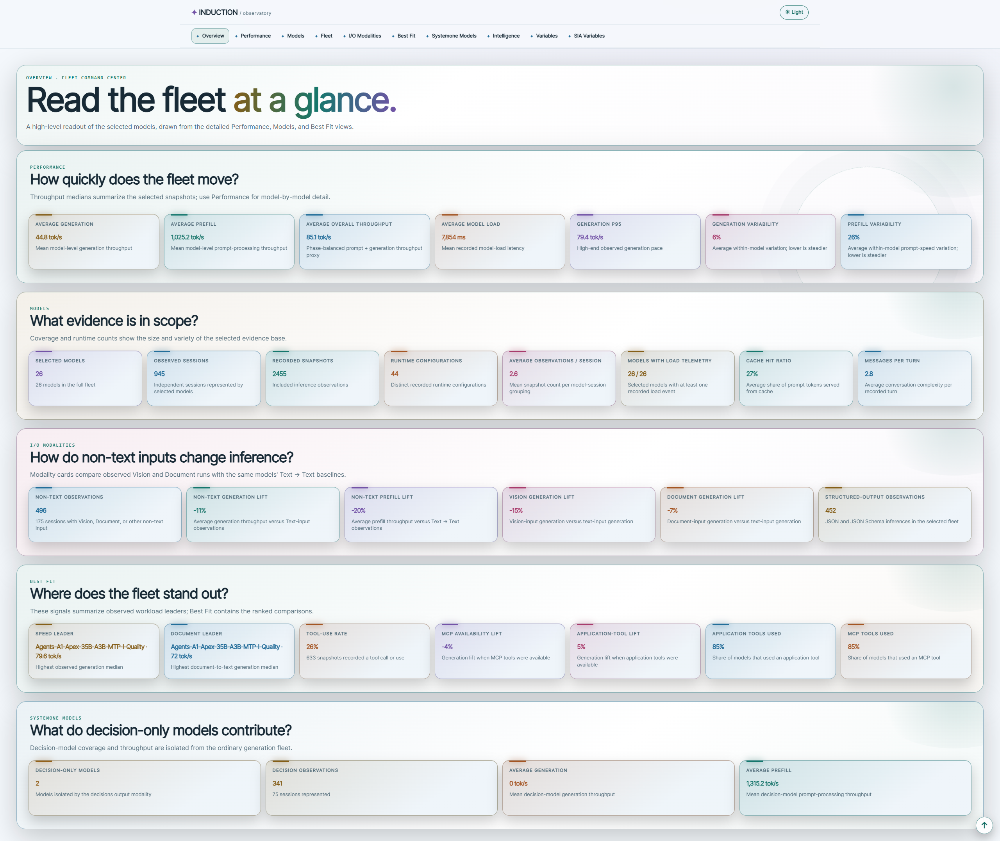
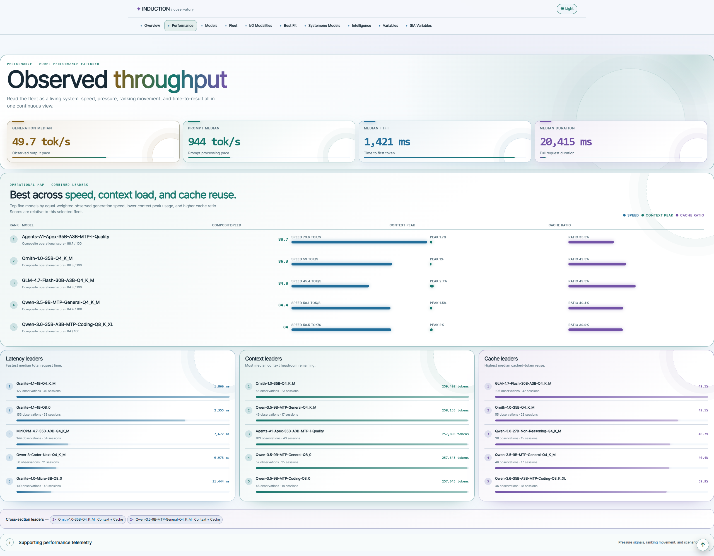
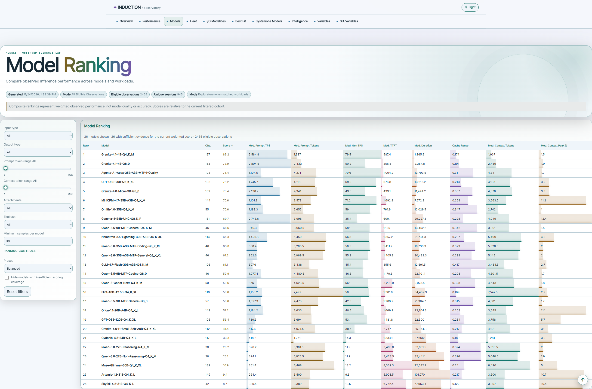
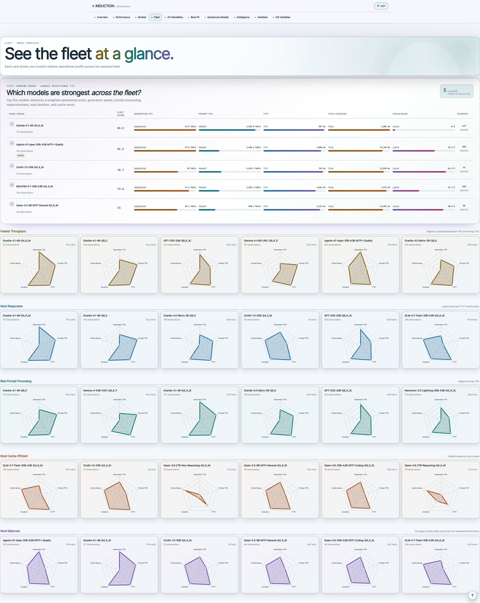
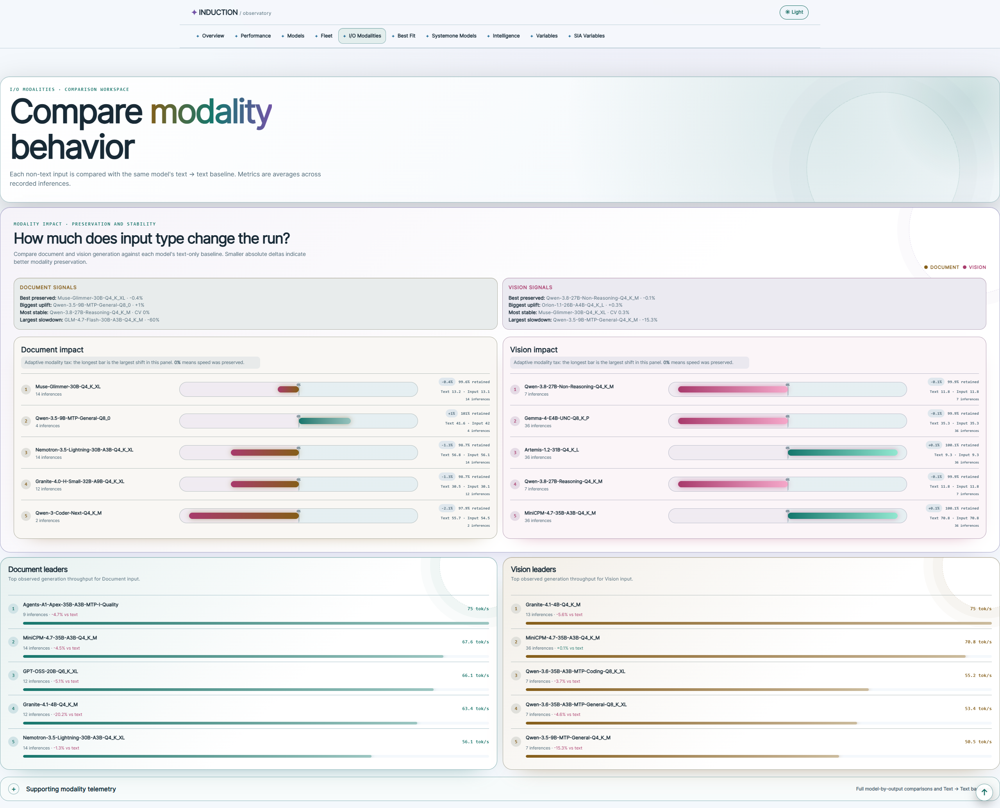
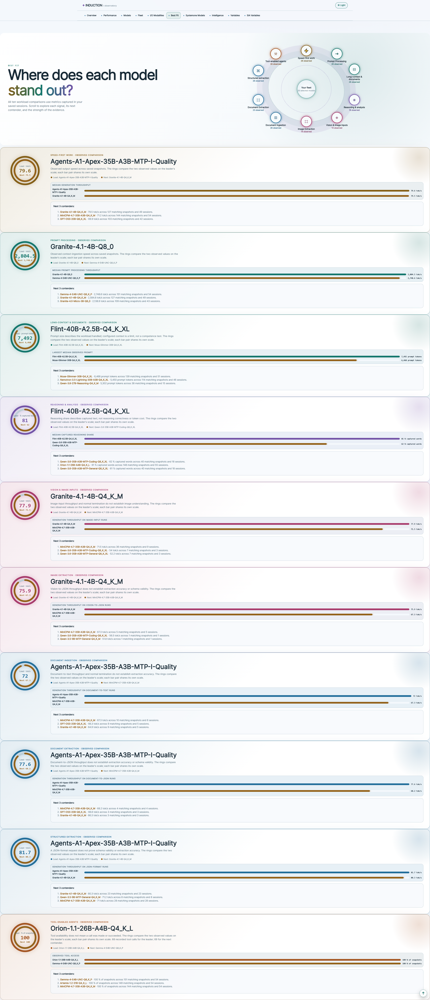
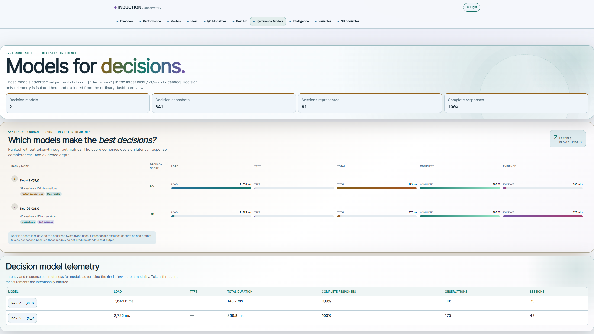
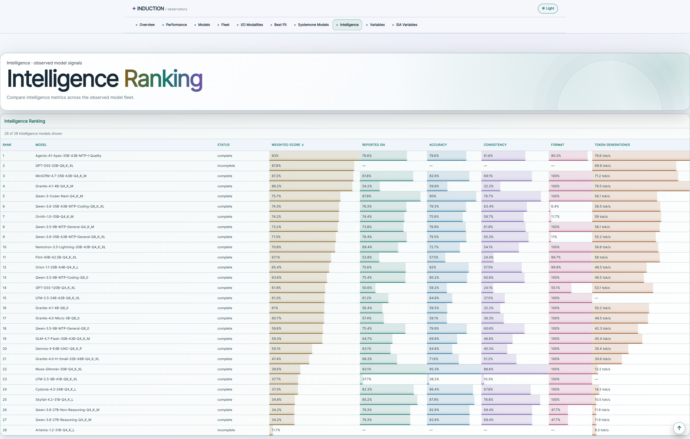

# Model observatory

`induction dashboard generate` builds a historical model-observatory projection
from persisted session snapshots. It writes
`data/dashboard/session_metrics.json` and a self-contained
`data/dashboard/dashboard.html`. Open the generated HTML with `file://`; it
requires no dashboard server or network connection. The dashboard is not live
monitoring: it reflects the sessions and evaluation results available when the
projection is generated.

The default inputs are `.sessions/`, evaluation results under
`data/evals/results/`, the optional local model catalog at
`data/.local/v1_models.json`, and the optional SIA report at
`data/dashboard/sia.json`. `.dashboardignore` can list exact model IDs to
exclude. Ignored models are removed from ordinary telemetry, evaluation
merges, SIA data, and Systemone model listings before the artifacts are
written. The generator also records source counts, skipped snapshots, and
evaluation inclusion counts in the JSON projection.

## Views

| View | Purpose |
| --- | --- |
| Overview | Compact fleet summary covering performance, evidence, modalities, Best Fit signals, and Systemone coverage. |
| Performance | Shows derived pressure signals, ranking movement across context bands, and estimated or measured inference-time breakdowns. |
| Models | Sortable model ranking table with operational metrics, filters, metric bars, multiple rankings, and a model inspector. |
| Fleet | Six-column model profile cards grouped into Fastest Throughput, Most Responsive, Best Prompt Processing, Most Cache-Efficient, and Most Balanced. |
| I/O Modalities | Compares non-text input behavior with each model’s Text → Text baseline. |
| Best Fit | Ranks models across workload-oriented operational signals. |
| Systemone Models | Isolates catalog models that advertise decision-only output. |
| Variables | Lists direct telemetry and inferred dashboard variables. |
| Intelligence | Optional SIA model ranking using the same table layout and interaction style as Models. |
| SIA Variables | Shows flattened key/value metrics from the optional SIA report. |

Navigation changes the active view and resets the document scroll position to
the top. The light/dark theme toggle is persisted locally. The dashboard is
responsive and includes keyboard-focusable controls, sortable tables, metric
bars, charts, and model/observation inspectors where the selected view
supports them.

## Models

The Models view compares standard-model observations and keeps decision-only
models in the separate Systemone view. Its filters operate at the observation
level:

- input type and output type;
- prompt-token and context-token minimum/maximum ranges, including paired
  lower and upper bounds;
- attachment presence and tool-use state;
- minimum samples per model;
- ranking presets for balanced, generation speed, prompt processing,
  responsiveness, and cache-aware comparisons;
- custom component weights for generation TPS, prompt TPS, TTFT, duration, and
  cache reuse; and
- optional hiding of models with insufficient scoring coverage.

The comparison uses all eligible observations after the active filters. Model
selection and matched-workload controls are retained in the data model for
compatibility but are not exposed as active controls in the current dashboard.
Composite scores are normalized relative to the filtered cohort and represent
observed operational performance, not accuracy or intrinsic model quality.
When the LineUp comparison library is available, the view also provides a
table/overview presentation with selectable rows; the native sortable table is
the fallback.

The native ranking table columns are:

`Rank`, `Model`, `Obs.`, `Score`, `Med. Prompt TPS`, `Med. Prompt Tokens`,
`Med. Gen TPS`, `Med. TTFT`, `Med. Duration`, `Cache Reuse`,
`Med. Context Tokens`, and `Med. Context Peak %`.

Every sortable header supports ascending and descending sorting. Numeric cells
use colored background bars behind their values. Rows can be selected or
highlighted and opened in the Metrics Inspector, which contains values,
source observations, runtime configuration, and optional raw JSON.

## Performance and recommendations

Performance combines observed fleet summaries with pressure views that relate
throughput and latency to prompt size, completion size, context size, TTFT,
post-first-token duration, cache reuse, reasoning tokens, messages, tool
calls, and attachments. It also includes ranking-shift and standardized
scenario sections; scenario values are estimates derived from observed
measurements and should not be read as benchmark guarantees.

Best Fit groups recommendations by workload-oriented signals such as
generation speed, prompt processing, responsiveness, cache behavior, and
balanced performance. A recommendation is relative to the observed fleet and
available evidence, not a universal model ranking. Fleet profiles use radar
charts across Generation TPS, Prompt TPS, TTFT, Duration, and Cache Reuse; a
model may appear in more than one profile.

I/O Modalities compares non-text input behavior with text-to-text observations
and shows modality-specific impact and leaders when enough evidence exists.
Systemone Models uses the local `/v1/models` catalog to identify models that
advertise `decisions` output and presents decision latency, completeness, and
evidence without ordinary token-throughput metrics.

## Fleet profiles

Fleet cards use Chart.js radar charts with the recommendations theme. Each
group has its own accent color and each radar uses a thick colored stroke with
a 25% opacity fill. The five profile dimensions are Generation TPS, Prompt
TPS, TTFT, Duration, and Cache Reuse. Models within each group are ordered
from strongest to weakest for that group’s score; a model can appear in more
than one group.

## Intelligence / SIA

SIA (shuffle-invariance assessment) is optional beta functionality. The
dashboard does not run SIA evaluations; run `induction run sia` separately
when an SIA report is desired.

If `data/dashboard/sia.json` exists, `dashboard generate` embeds its useful
metrics as the top-level `sia` node in `session_metrics.json`. If it is absent,
the generator writes `sia: []`. The Intelligence view remains available and
shows an empty state when no report is present.

Intelligence uses the same full-width ranking-table presentation as Models,
but with SIA metrics: weighted score, reported SIA, accuracy, consistency,
format adherence, and token generation speed. Columns are sortable, numeric
cells use percentage bars, and model rows open the same inspector. The
Intelligence sidebar has been removed.

SIA metrics and visualizations may change without backward compatibility while
the enhancement is being developed. Do not compare SIA scores with unrelated
benchmarks or interpret them as general task accuracy.

